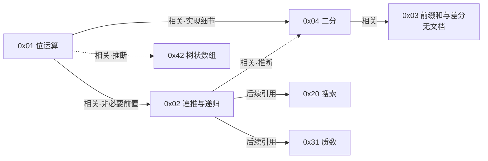

# 知识库内化状态（第一轮）

> 本文档记录对**已有知识库 Markdown** 的系统内化结果，不代替章节文档本身。
>
> **材料边界**：本轮只阅读 `docs/knowledge-base/` 下已提交的 Markdown，
> 未打开教材 PDF、扫描页或 OCR 全文。因此文中所有「原书结论」都是**经由知识库文档转述**的，
> 二次转述可能存在偏差；凡标 `[BOOK]` 之处均附文档中记录的印刷页码，便于回查。
>
> 标记约定：
> - `[BOOK]` 知识库文档标注为原书明确给出的内容
> - `[DERIVED]` 文档或本轮的推导/归纳
> - `[MY-NOTE]` 本轮内化时形成的理解、类比或疑问
> - `[?]` 尚未确认，不得当作结论使用

---

## 1. 全书知识体系概览

### 1.1 教材与结构

本书的章节层级是：**一级块 → 二级章节**。按 `chapter-status.md` 的实际行数统计：

| 计数口径 | 数量 | 说明 |
| --- | --- | --- |
| 一级块（正文） | **8** | `0x00`、`0x10`、`0x20`、`0x30`、`0x40`、`0x50`、`0x60`、`0x70` |
| 编号条目总数 | **73** | = 65 正文章节 + 7 个「总结与练习」+ 1 个附录 |
| 正文章节 | **65** | 不含 7 个总结章与附录 |
| 「总结与练习」 | **7** | `0x08`、`0x18`、`0x29`、`0x3B`、`0x49`、`0x5E`、`0x6B` |
| 附录 | **1** | `0x7F`（例题/习题索引），`book-outline.md` 把它单列为一个块 |
| 视附录为一级单位时的块数 | 9 | 与 `book-outline.md` 的分块写法一致 |

各一级块的章节数（含该块内的总结章）：

| 一级块 | 章节数 | 页码范围 | 主题 |
| --- | --- | --- | --- |
| `0x00` 基本算法 | 8 | p.1–48 | 位运算、递归、前缀和、二分、排序、倍增、贪心 |
| `0x10` 基本数据结构 | 8 | p.49–91 | 栈、队列、链表、Hash、字符串、Trie、二叉堆 |
| `0x20` 搜索 | 9 | p.93–133 | 遍历、DFS、剪枝、迭代加深、BFS、A*、IDA* |
| `0x30` 数学知识 | 11 | p.134–191 | 质数、约数、同余、矩阵、高斯消元、计数、期望 |
| `0x40` 数据结构进阶 | 9 | p.192–261 | 并查集、树状数组、线段树、分块、点分治、平衡树 |
| `0x50` 动态规划 | 14 | p.263–348 | 线性/背包/区间/树形/状压/数位/斜率优化 |
| `0x60` 图论 | 11 | p.349–455 | 最短路、MST、LCA、Tarjan、二分图、网络流 |
| `0x70` 综合技巧 | 3 | p.456–488 | STL、对拍、附录 |

> **两个索引文件的结构核对**（本轮按行重新解析，不再沿用旧口径）：
>
> | 文件 | 行数 | 构成 |
> | --- | --- | --- |
> | `book-outline.md` | **82** 条 `\| 0x` 记录 | 9 条一级块标题（`总览` 表的 4 列行）+ **73 条二级章节记录**（6 列行） |
> | `chapter-status.md` | **73** 条章节记录 | 73 条二级章节，无总览行 |
>
> 逐项比对结果：去掉 9 条一级块标题后，`book-outline.md` 的 73 个章节编号与
> `chapter-status.md` 的 73 个编号**逐项一致、顺序相同**（已用脚本核对，无缺漏、无重复）。
> `0x7F` 出现两次是**分别作为一级块标题和附录章节**，不是重复章节。
>
> **真正错误的是两份文件末尾的汇总数字**：`chapter-status.md` 写「合计 55 / 未开始 52」，
> 与它自己的 73 条记录不符；`book-outline.md` 的统计合计同样对不上 73。
> 这两处属于**底层索引的汇总错误，待单独立项修复**；本轮按指令**未修改**它们，
> 本报告也不使用 55/52 作为事实，一律采用可逐行复核的 73/65/62 等口径。

页码与章节名以知识库 `book-outline.md` / `chapter-status.md` 为准，两处均记录了两处「任务书 vs 原书」的差异：
`0x31` 是**质数**（不是「数论」）、`0x65` 是**负环与差分约束**（不是「强连通分量」，SCC 在 `0x67`）。

### 1.2 知识库实际内容

| 文件 | 作用 | 状态 |
| --- | --- | --- |
| `README.md` | 使用说明、来源标记规范 | 完整 |
| `book-profile.md` | 书目、扫描质量、页码换算 | 完整 |
| `book-outline.md` | 章节目录与页码（82 行 = 9 个一级块标题 + 73 条章节；章节编号与 status 逐项一致） | 完整（末尾汇总数字待修） |
| `chapter-status.md` | 逐章进度（权威） | 完整 |
| `source-map.md` | 来源索引 SRC-001~032、OCR 疑点 OCR-001~011 | 随章节增长 |
| `concept-index.md` | 概念索引 | 仅覆盖 3 章 |
| `dependency-map.md` | 依赖关系 D-001~015 | 仅覆盖 3 章 |
| `terminology.md` | 术语表 | 仅覆盖 0x01/0x04 |
| `code-style.md` | 书中代码风格观察 | 样本有限 |
| `quality-checklist.md` | 质量检查清单 | 完整 |
| `templates/` | 章节/概念模板 | 完整 |
| `chapters/…` | 章节文档 | **仅 3 章** |

### 1.3 章节地图（按实际完成度）

```
0x00 基本算法
├─ 0x01 位运算            [已整理]  ████████░░  5 项待确认
├─ 0x02 递推与递归        [已整理]  ████████░░  3 页待复核
├─ 0x03 前缀和与差分      [无文档]  ░░░░░░░░░░  被 0x04 例题间接引用
├─ 0x04 二分              [已核验]  █████████░  2 项未收录
├─ 0x05 排序              [未开始]
├─ 0x06 倍增              [未开始]
├─ 0x07 贪心              [未开始]
└─ 0x08 总结与练习        [未开始]

0x10 ~ 0x70 与附录（65 条 = 58 正文 + 6 总结 + 1 附录）  全部未开始
```

> 任务书把 `0x03` 列入「重点核对」，但仓库中**不存在** `0x03` 文档，
> `chapter-status.md` 也记为「未开始」。本轮据此如实记录，不代写。

---

## 2. 已有章节内化记录

### 2.1 `0x01` 位运算（p.1–10）

**核心问题**：计算机如何用二进制表示与运算整数，以及如何把这些性质当作算法工具。

**基本原理**

- **补码的加法**：减法被转成「加负数」，加法执行时**每一位的进位照常发生**；
  所谓「不进位」只指**最高位产生的进位被丢弃**（相当于模 2³²），而不是逐位都不进位 `[BOOK] p.2`。
  - `[MY-NOTE]` 这两种「进位」必须分开说：逐位进位是加法本身的机制（`1+1=10` 会向高位进 1），
    最高位溢出进位则是被类型宽度丢弃的那一位。把二者混为一谈会得出「补码加法和普通二进制加法不一样」的错误印象。
  - `[MY-NOTE]` 也正因最高位进位被丢弃，`int` 的 `0x7FFFFFFF + 1` 才会变成负数；
    标准 C++ 中这属于**有符号溢出（未定义行为）**，见 §2.1 的 64 位乘法说明。
- 无符号整数的加减等价于对 2³² 取模；有符号整数在**真实硬件**上通常表现为同样的位模式回绕，
  但在 C++ 标准里这是未定义行为，不能依赖 `[DERIVED]`。
- 位运算**不进位**，因此各位相互独立——这是状态压缩、按位贪心的共同前提 `[BOOK] p.6, p.8`。

**关键性质**

| 性质 | 适用条件 | 来源 |
| --- | --- | --- |
| `1 << n = 2^n` | n 不越界 | `[BOOK] p.3` |
| `x >> 1` 向下取整，`x / 2` 向零取整 | 含负数时二者不同 | `[BOOK] p.4` |
| `lowbit(n) = n & -n` | n ≥ 0 | `[BOOK] p.9–10` |
| `n xor 1` 使偶数 +1、奇数 −1 | n ≥ 0 | `[BOOK] p.9` |
| `0x3F3F3F3F` 可安全当正无穷 | 需保证两倍不溢出 | `[BOOK] p.3` |
| `memset` 只能按字节填充 | 只能构造「每 8 位相同」的值 | `[BOOK] p.3` |

**关键推导（内化后的复述）**

1. **快速幂 O(log b)**：把 b 二进制拆分，`a^{2^i} = (a^{2^{i-1}})^2` 递推，逐位决定是否乘入 `[BOOK] p.4`。
2. **64 位乘法方法二（浮点估商）**：`a*b mod p = a*b - ⌊a*b/p⌋*p`。用 `long double` 估商，再用整数存 `a*b` 与 `c*p` 的差 `[BOOK] p.6`。
   这个技巧依赖「模 2⁶⁴ 的同余类仍能还原真实差值」，因为真实差值 < 2⁶⁴。
   但它的**正确性有前置条件**（输入约简、无符号语义、估商误差 ≤ 1），详见下方补充。
3. **lowbit 推导**：取反后低位全 1、第 k 位为 0，加 1 进位回 1、低位归 0、高位全反；与自身相与只剩第 k 位 `[BOOK] p.10`。

#### 补充：64 位乘法方法二的实现前提（本轮补充）

**(1) 输入约简是前提**

必须先执行 `a %= p; b %= p;`，使 `0 ≤ a, b < p`：

- 未约简时 `a*b` 可达 `10^36`，`⌊a*b/p⌋` 同样可达 `10^36`，**远超 64 位整数**；
- 约简后 `⌊a*b/p⌋ < p ≤ 10^18 < 2^60`，才能放进 64 位整数。

原书代码注释「当 a, b 一定在 [0, p) 之间时，此行不必要」说的就是这件事 `[BOOK] p.6`。

**(2) 无符号语义与转换时机**

- `unsigned long long` 的乘法与减法是**定义良好的模 2^64 运算**（有符号整数的回绕则不是）。
- 标准 C++ 中 `long long` 溢出是**未定义行为**，不能当作「自动舍弃高位」。
- 关键：必须在**乘法之前**转换。写成 `(unsigned long long)(a * b)` 是错的——
  `a * b` 已先以 `long long` 求值，UB 在转换之前就发生了。
  正确顺序是 `(u64)a * (u64)b`，让乘法和减法本身都在无符号类型中进行。

**(3) 估商误差：80-bit 的完整推导**

**适用前提**（缺一不可，方法二只在这些前提下才成立）：

1. 已做输入约简：`0 ≤ a, b < p ≤ 10^18 < 2^60`；
2. `a`、`b`、`p` 都能被 **64 位 significand 精确表示**（小于 `2^60` 的整数满足这一点）；
3. 使用 **x87 80-bit `long double`**（64 位尾数），舍入方式为 **round-to-nearest**；
4. 乘法与除法各只做**一次** 80-bit 舍入，中间结果不被降精度存储（例如没有被存回 `double`）；
5. 不启用 `-ffast-math` 等会改变浮点语义的优化；
6. 整数类型 `u64` 恰为 **64 位**（`numeric_limits<u64>::digits == 64`），否则「模 2^64」不成立。
   第 6 条针对整数侧，前 5 条针对浮点侧，二者缺一不可。

**推导**：令 `u = 2^-64`，`fl(·)` 表示一次舍入。

- 由前提 2，`fl(a) = a`、`fl(b) = b`（转换本身无误差）。
- 乘法一次舍入：`m = fl(a·b) = a·b·(1+δ₁)`，`|δ₁| ≤ u`。
- 除法一次舍入：`ĉ = fl(m/p) = (a·b/p)·(1+δ₁)·(1+δ₂)`，`|δ₂| ≤ u`。
- 相对误差：`|(1+δ₁)(1+δ₂) − 1| = |δ₁ + δ₂ + δ₁δ₂| ≤ 2u + u²`。
  其中 `2u + u² = 2^-63 + 2^-128`，**略大于** `2^-63`（`2u` 已取满，另加 `u² > 0`），
  因此取严格成立的上界：`2u + u² < 2^-62`（因 `2^-128 < 2^-63`）。
- 绝对误差：`< (a·b/p)·2^-62 < p·2^-62 < 2^60·2^-62 = 1/4`。

**为什么 `abs(c−q) ≤ 1`**：记 `r̂ = a·b/p`、`q = ⌊r̂⌋`，则 `q ≤ r̂ < q+1`。
浮点值满足 `|ĉ − r̂| < 1/4`，故 `q − 1/4 < ĉ < q + 5/4`。截断到整数后
`c ∈ {q−1, q, q+1}`，即偏差**至多 1**（不会更大）。

**为什么单步校正够用**：三种情形的差值与修正见 (4)，两个条件互斥且覆盖全部可能。

> 以上是**在前提 1–5 都成立时**的推导，不是任何 C++ 编译器都保证的性质。
> MSVC 的 `long double` 只是 `double`，前提 3 不成立，方法二不适用。

**(3b) 为什么不能对 `double` 做同样的论证**

`double` 的尾数是 53 位（`u = 2^-53`）。把上面的 `2u` 直接套用，只能说明
**「输入已被精确表示」时乘除法这两步运算**的相对舍入误差量级约为 `2^-52`；
它**不覆盖**整数到 `double` 的转换误差，也不是端到端的估商误差上界。

实际链路里至少还有三处会引入误差：`a`、`b`、`p` 的整数→double 转换，
以及转换后再做乘、除的两次舍入。转换误差尤其关键：
当 `a > 2^53` 时，`(double)a` 本身就已经变了。

所以本报告**不对 double 情形给出任何"误差上界"或"端到端界"**，
只用反例和实验说明「精度不足以保证 `abs(c−q) ≤ 1`」。

**可复现反例**（本轮用 g++ 11.5.0 实机验证）：

```
p = 1000000000000000000
a = b = 999999999999999999

a*b                = 999999999999999998000000000000000001
真实 floor(a*b/p)  = 999999999999999998      （余数 1）

(double)a = (double)b = 1000000000000000000  （> 2^53，转 double 时被舍入）
double 算得 a*b/p  = 1000000000000000000
double 估商 c      = 1000000000000000000
偏差 c − q         = +2
```

原因是 `999999999999999999 > 2^53`，转成 `double` 时已经变成 `10^18`，
后续乘除再舍入，误差被放大到 2 —— 单步校正只能救 ±1。

同一组数据用 x87 80-bit 计算（`printf("%.21Lf")` 的实际输出）：

```
long double 算得 a*b/p = 999999999999999998.0625
估商 c = 999999999999999998  →  偏差 0
```

> 该值在 80-bit 下可精确表示（二进制尾数有限），因此这里用等号；
> 早期版本写成 `...998.1` 是四舍五入到一位小数的近似，用等号表示不严谨，已更正。

**实验观察**（30 万随机 + 边界，`p` 取到 `10^18`；这些是**实测数据，不是理论上界**）：

| 精度 | 用例 | 失败数 | 实测最大 `abs(c−q)` |
| --- | --- | --- | --- |
| 80-bit `long double` | 边界 + 30 万随机 | **0** | 1 |
| 53-bit `double`（模拟 MSVC） | 边界 | 77 | 15 |
| 53-bit `double`（模拟 MSVC） | 30 万随机 | 202,800 | 242 |

> 结论：80-bit 的结论有推导支撑（前提 1–5），double 的结论只有反例 + 实验支撑；
> 无论哪种，`double` 都**不满足**单步校正的要求，这一点是确定的。

**(4) 两种偏移的识别与修正**

记 `T = a*b − q*p ∈ [0, p)`：

| 估商情况 | 差值 `r = a*b − c*p` | 识别方式 | 修正 |
| --- | --- | --- | --- |
| `c = q` | `T ∈ [0,p)` | 正常 | 无需修正 |
| `c = q − 1` | `T + p ∈ [p, 2p)` | `r >= p` | `r -= p` |
| `c = q + 1` | `T − p < 0` → 回绕为 `2^64 − (p − T)` | `r > ULLONG_MAX − p` | `r += p` |

两条件互斥，先判回绕（偏大）再判偏小即可。整理者按此逻辑改写的参考实现 `[DERIVED]`（非原书代码）：

```cpp
#include <limits>

using u64 = unsigned long long;
static_assert(std::numeric_limits<u64>::digits == 64,
              "方法二依赖 u64 恰为 64 位（模 2^64 语义）");

u64 mul_mod(u64 a, u64 b, u64 p) {
    if (p == 1) return 0;
    a %= p; b %= p;                              // 必需：保证商 < p
    u64 c = (u64)((long double)a * (long double)b / (long double)p);
    u64 r = (u64)a * (u64)b - (u64)c * p;        // 无符号，模 2^64
    if (r > ~0ull - p) r += p;                   // 估商偏大，回补
    if (r >= p) r -= p;                          // 估商偏小，扣除
    return r;
}
```

> **`u64` 必须是 64 位**：整段代码依赖「乘减按模 2^64 回绕」，若 `unsigned long long`
> 不是 64 位（理论上允许更宽），`(u64)a * (u64)b` 的模就不是 2^64，校正逻辑失效。
> 上面的 `static_assert` 把这一条变成编译期检查；它同时是 (3) 中的**前提 6**。

定向验证：取 `p = 10^9+7`、`a = b = p−1`，人为令 `c = q−1 / q / q+1`，三种情形均能还原正确的 `T`。

**(5) 结论与建议**

- 方法二的正确性依赖 **(3) 中列出的全部六条前提同时成立**：
  ① 输入约简 `0 ≤ a,b < p`；② `a,b,p` 可由 64 位 significand 精确表示；
  ③ x87 80-bit `long double` + round-to-nearest；④ 乘法/除法各一次舍入且中间不降精度；
  ⑤ 无 `-ffast-math` 等语义改写；⑥ `u64` 恰为 64 位。
  缺少任一条，`abs(c−q) ≤ 1` 与单步校正都不再有保证。
- 因此在 MSVC（`long double` 等同 `double`）上**不可移植**，不能写成通用写法。
- 推荐优先级：
  1. **方法一（倍增）**——纯整数，无 UB、无精度依赖，任何平台都对；
  2. 编译器支持 `__int128` 时，直接 `(unsigned __int128)a * b % p`；
  3. 只有确认目标工具链是 x86 80-bit `long double` 时，才使用方法二，并对边界数据实测。
- 原书把方法二作为「另一种思路」介绍 `[BOOK] p.6`；其实现依赖书中未讨论，
  本报告把它标注为**平台相关技巧**，而非可移植保证。

**(6) 原书 0x01 章节中的三处旧表述（本轮登记，不修改原章节）**

原书 0x01 有三处表述建立在「有符号溢出等同于取模」的旧理解上，
这是**原书写作年代的实现描述**，不能当作现代标准 C++ 的行为保证：

| 原书位置 | 原书说法 | 问题所在 |
| --- | --- | --- |
| 章首（p.2） | 「无符号溢出相当于自动对 2^32 取模，这解释了有符号整数上溢出时出现负数的现象」 | 前半句**正确**（无符号确有定义良好的模运算）；但用它去"解释"有符号溢出，会让人误以为有符号溢出也受标准保证——实际是 **UB** |
| §3.5（p.6） | 方法二把 `a*b - c*p` 的差存进 `long long` | 保存类型应为 `unsigned long long` |
| §4.2（p.6） | 「溢出相当于舍弃高位，正好得到所需的低位差」 | 同样只对**无符号**成立，对有符号是 UB |

正确的关系是：

| 项目 | 原书表述 | 现代标准 C++ 的要求 |
| --- | --- | --- |
| 保存差值的类型 | `long long` | 必须 `unsigned long long` |
| 溢出语义 | 视为模 2^64 舍弃高位 | 有符号溢出是 **UB**；只有无符号才有定义良好的模运算 |
| 类型转换时机 | 直接用有符号结果 | 必须在**乘法之前**转换：`(u64)a * (u64)b` |
| 章首的"取模解释" | 用无符号取模解释有符号现象 | 无符号：标准保证的模 2^32；有符号：**UB**，实现上常表现为回绕，但不可依赖 |

> - 本轮**未修改** 0x01 章节原文：它不在本 PR 的授权范围内，若要修订需单独授权。
> - 安全写法请直接引用本文件 §2.1 的 `[DERIVED]` 参考实现（先约简、乘法前转 unsigned、单步校正）。
> - 任何新代码都**不应**依赖「`long long` 溢出自动舍弃高位」或「有符号溢出就是取模」这两类说法。

**复杂度**（三种算法分别列出，不合并）

| 算法 | 时间复杂度 | 空间 | 来源 |
| --- | --- | --- | --- |
| 快速幂 | `O(log b)` | `O(1)` | `[BOOK] p.4` |
| 64 位乘法·方法一（倍增） | `O(log b)`：循环 `log b` 次，每次常数次加/乘/取模 | `O(1)` | `[BOOK] p.5`、`[DERIVED]` |
| 64 位乘法·方法二（浮点估商） | **`O(1)`**：一次浮点除法 + 两次乘法 + 一次减法 | `O(1)` | `[DERIVED]` |
| lowbit | `O(1)` | `O(1)` | `[BOOK] p.10` |

> 常见错误是把方法一与方法二都写成 `O(log b)`——**方法二并没有循环**，它是常数时间；
> 方法一才需要 `log b` 次迭代。两者是「时间换精度安全」与「常数换平台依赖」的取舍。

**实现细节与坑**

- 两个 `int` 相乘仍是 32 位，必须 `(long long)` 强转 `[BOOK] p.5`。
- `x & 1 == 0` 会按 `x & (1 == 0)` 结合（比较优先于位与）`[BOOK] p.7–8`。
- `lowbit(0) = 0`，枚举 1 位时循环条件须为 `n > 0`。
- 右移是算术还是逻辑由编译器决定，本书默认算术右移 `[BOOK] p.4`。

**算法联系**

- 向后：`0x13` 成对变换用于邻接表反向边；`0x14` lowbit+Hash 枚举 1 位；`0x56` 状压 DP；`0x04` 右移与除法差异 `[BOOK]`。
- `[MY-NOTE]` 本章真正的「枢纽」是 lowbit：它同时通向树状数组、状压枚举、二进制拆分三处。

**教学价值**：位图动画（取反加一、lowbit、逐次平方）成本低、效果直观，是全库最适合做**交互式位运算实验台**的一章。

**本轮发现的文档问题**

- §1 状态写作「**在**整理」，与 `chapter-status.md` 的「已整理」不一致。
- 正文有约 6 处「已」被写成「在」（如「代码**在**核对」「**在**逐字符核对」「**在**按 OCR 记录」），疑似批量替换事故。
- 上述问题**未修改**（本轮只读），见 §5。

---

### 2.2 `0x02` 递推与递归（p.11–21）

**核心问题**：如何遍历「状态空间」——从边界正向推导（递推）或从原问题反向缩小（递归）。

**基本原理**

- **相似性前提**：每一步变换面对的都是同类子问题，仅在规模或限制上不同，因此可复用同一段程序 `[BOOK] p.12`。
- 递归三操作：**缩小 → 求解 → 扩展**；失败则回溯尝试其它路线 `[BOOK] p.12`。
- **还原现场**：保证「求解」前后问题状态一致，否则「缩小」与「扩展」无法衔接 `[BOOK] p.13`。

**关键性质**

| 性质 | 说明 | 来源 |
| --- | --- | --- |
| 递推方向 | 边界 → 原问题 | `[BOOK] p.11` |
| 递归方向 | 原问题 → 边界 → 回溯 | `[BOOK] p.11` |
| 枚举形式 | 多项式 / 指数 `2^n` / 排列 `n!`（组合 `C(n,m)` 为文档补充） | `[BOOK] p.13` + `[DERIVED]` |
| 剪枝判据 | 已选 > m，或「已选 + 剩余」< m | `[BOOK] p.14` |
| 四塔递推 | `f[n] = min{2f[i] + d[n-i]}`，`f[1] = 1` | `[BOOK] p.16` |

**关键推导（内化后的复述）**

1. **指数型枚举的正确性**：每层恰好覆盖「选/不选」两条互斥分支，递归树叶子数 `2^n`，故穷尽方案 `[DERIVED]`。
2. **组合剪枝**：两条判据都在进入分支时即可判定，故能在到达边界前整棵剪掉 `[BOOK] p.14`。
3. **费解的开关**：① 每格最多点一次；② 固定第一行后方案唯一——因为第 i 行某位为 1 时只能点第 i+1 行对应格；③ 顺序无关。于是只需枚举第一行 `2^5 = 32` 种 `[BOOK] p.16`。
4. **等比数列分治**：奇数式 `S(p,c) = (1+p^{(c+1)/2})·S(p,(c-1)/2)`；偶数式 `S(p,c) = (1+p^{c/2})·S(p,c/2-1) + p^c` `[BOOK] p.17`。
   - `[MY-NOTE]` 偶数式的直觉：把前 c/2 项抽出来 → 剩下的是 `p^{c/2}·(1+…+p^{c/2-1})`，再加上末项 `p^c`。
   - 边界 `S(p,0)=1` 文档标为整理者补充 `[DERIVED]`。
5. **分形坐标**：四象限分别对应旋转 + 翻转，输出为 0-based `[BOOK] p.19`。

**复杂度**

| 枚举 | 节点/方案数 | 计入输出的时间 | 来源 |
| --- | --- | --- | --- |
| 指数型 | `O(2^n)` | `O(n·2^n)` | `[DERIVED]` |
| 组合型 | `C(n,m)` | `O(n·C(n,m))` | `[DERIVED]` |
| 排列型 | `n!` | `O(n·n!)` | `[DERIVED]` |
| 等比数列和 | — | 见下 | 见下 |

> 等比数列和的 `O(log c)` 是原书结论 `[BOOK] p.17`；但若**每层独立调用快速幂**，
> 递推为 `T(c) = T(c/2) + O(log c)`，实际是 `O(log² c)`。
> 只有递归同时返回「和」与「该层幂次」才能达到 `O(log c)`。文档已区分，本轮确认该分析成立 `[DERIVED]`。

**实现细节与坑**

- `push_back` / `pop_back` 必须成对；忘记还原现场会让后续分支读到脏数据 `[BOOK] p.13`。
- 边界是 `x == n + 1`，写成 `x == n` 会漏最后一位。
- 剪枝里 `n - x + 1` 是「剩余可选数量」，漏 `+1` 会少算一个。
- 递归过深 → 栈溢出；例题把 n 限制在 20/10 以内 `[BOOK] p.14–15`。
- **存储期**：全局与 `static` 局部变量是**静态存储期**，不在堆上；`[MY-NOTE]` 这是最容易讲错的一点，书中简化模型 + 现代 C++ 解释需同时给出。
- 非递归改写：数组模拟栈、`switch` 模拟跳转，`case 0/1/2` 分别对应函数头、选 x、回溯 `[BOOK] p.20–21`。

**算法联系**

- 前：`0x01`（指数枚举的位运算写法）。
- 后：`0x20` 搜索（剪枝）、`0x31/0x32`（Sumdiv 需要的质因数分解）。
- `[MY-NOTE]` 本章是全书的「方法论枢纽」：递归/回溯/剪枝/分治四种思想都在这里首次出场，后续 DP、搜索、分治数据结构都复用它。

**教学价值**：递归调用树、栈帧进出、分形逐级生成，都适合做**分步动画 + 代码同步**。

**本轮发现的文档状况**

- p.12、p.13、p.18 三页文字仍为 OCR 转录，未目视复核（文档已如实标注）。

---

### 2.3 `0x03` 前缀和与差分

**状态：无文档。** `chapter-status.md` 记为「未开始」，`chapters/` 下无对应文件。

- 只知它位于 p.21–24，且 `0x02` 的非递归代码占用了 p.21 上半页。
- `0x04` 的 Best Cow Fences 例题用到「前缀和相减」，属于**间接依赖** `[BOOK] p.30`。
- 本轮**不代写**，也不根据记忆补充内容。

---

### 2.4 `0x04` 二分（p.25–31）

**核心问题**：在单调结构中快速定位；把「求最优解」转化为「判定可行性」。

**基本原理**

- 单调性 = 「一侧合法、另一侧不合法」的分界结构；一次比较即可排除整段 `[BOOK] p.25`。
- 本书统一写法：**答案始终在闭区间 `[l, r]` 内**，循环以 `l == r` 结束 `[BOOK] p.26`。

**关键性质**

| 性质 | 说明 | 来源 |
| --- | --- | --- |
| 后继型 | `r = mid` / `l = mid + 1`，`mid = (l+r)>>1` | `[BOOK] p.26` |
| 前驱型 | `l = mid` / `r = mid - 1`，`mid = (l+r+1)>>1` | `[BOOK] p.26` |
| mid 取值 | `(l+r)>>1` 取不到 r；`(l+r+1)>>1` 取不到 l | `[BOOK] p.27` |
| 无解处理 | 区间扩到 `[1,n+1]` / `[0,n]`，停在越界下标即无解 | `[BOOK] p.27` |
| 实数精度 | 保留 k 位取 `eps = 10^{-(k+2)}` | `[BOOK] p.27` |
| 三分前提 | 函数在区间上**严格**单峰（或严格单谷）；存在一段函数值相等时方向判断失效 | `[BOOK] p.28` |

**关键推导（内化后的复述）**

1. **为什么 `r = mid` 而不是 `mid - 1`**：`mid` 自身可能就是答案，排除它会丢解 `[BOOK] p.26`。
2. **为什么 mid 取法必须与形式配套**：若前驱型误用 `(l+r)>>1`，当 `r-l=1` 时 `mid=l`；走 `l = mid` 不缩小 → 死循环；走 `r = mid-1` 则 `l > r`，无法以 `l==r` 结束 `[BOOK] p.26`。
3. **二分答案的单调性**：设最优值 S。`x > S` 不存在合法方案；`x ≤ S` 最优解本身即满足；故值域是「S 一侧合法、另一侧不合法」的分段函数 `[BOOK] p.28`。
4. **三分法的适用条件与判定**（这里最容易说错，单独展开）：

   **函数形状的要求** `[BOOK] p.28`：

   - **单峰函数**：存在**唯一**极大值点 `x*`，在 `x*` 左侧**严格递增**、右侧**严格递减**；
   - **单谷函数**：存在**唯一**极小值点 `x*`，在 `x*` 左侧**严格递减**、右侧**严格递增**。
   - 「严格」是关键：区间内**不允许出现一段函数值相等的平台**。

   **判定规则**（以求极大值为例）`[BOOK] p.28`：

   | 比较结果 | 结论 | 收缩 |
   | --- | --- | --- |
   | `f(lmid) < f(rmid)` | 两点要么同在 `x*` 左侧，要么分居两侧；无论哪种，`x*` 都在 `lmid` 右侧 | `l = lmid` |
   | `f(lmid) > f(rmid)` | 对称地，`x*` 都在 `rmid` 左侧 | `r = rmid` |
   | `f(lmid) == f(rmid)` | 严格单峰下可任选一侧收缩；**存在平台时无法判断方向**，三分失效 | 书中未给出通用做法 |

   `[MY-NOTE]` 三点澄清：
   1. **“有唯一极值点”不足以支撑三分**——还要求两侧严格单调。反例：`f` 在左侧有一段水平段，`lmid`、`rmid` 都落在平台两侧时仍可能判断正确，但一旦其中一点落在平台内，`f` 的相等就会让方向判断失去依据。
   2. **求极小值要把不等号反过来**：`f(lmid) > f(rmid)` 时 `l = lmid`，否则 `r = rmid`。书中只以单峰（极大）为例，单谷需自行对称推导 `[DERIVED]`。
   3. **三分与二分不同**：二分要求“一侧合法、另一侧不合法”的**单调性**；三分要求的是**单峰性**（先增后减），二者前提不能互换。

**复杂度**

- 整数二分 `O(log n)`；实数二分 `O(log(1/eps))`；三分每次缩小 1/3 或约 1/2，仍是 log 级 `[BOOK] p.28`。
- 二分答案：`O(判定复杂度 × log 值域)`。Best Cow Fences 为 `O(n log(1/eps))` `[DERIVED]`。

**实现细节与坑**

- 两套模板的 mid 取法不能混用。
- 收缩时忘掉「mid 可能是答案」会漏解。
- 实数二分固定次数（书中用 100 次）通常比设 eps 更稳 `[BOOK] p.27`；文档记录实测误差分别为 `1.47e-6` 与 `0`。
- 值域含负数时不能用 `/ 2` `[BOOK] p.26`。
- `[MY-NOTE]` 站点现有 `binary-search.html` 用**左闭右开** `[l, r)`，与书中闭区间写法不同，教学时必须明确对比，否则学生两套混用必错。

**算法联系**

- 相关：`0x01`（右移与除法）、`0x03`（前缀和）、`0x71`（lower_bound/upper_bound）。
- 被依赖：`0x39` 0/1 分数规划等以实数二分为工具（推断）。
- `[MY-NOTE]` 注意区分「二分查找」与「二分图」，二者只是中文撞名。

**教学价值**：区间收缩动画 + 两模板对比 + 交互式「猜下一步」，是全书最容易做出高质量可视化的章节之一。

---

## 3. 知识关联图

### 3.1 已有章节之间的关系



### 3.2 三类关系（与 `dependency-map.md` 一致）

| 类型 | 含义 | 本库中的例子 |
| --- | --- | --- |
| 前置依赖 | 不掌握就无法理解 | **目前没有书中明确表述的前置依赖** |
| 相关知识 | 互相参照，不构成门槛 | `0x01 → 0x04`（右移 vs 除法）、`0x01 → 0x02`（位运算写法） |
| 后续引用 | 书中「详见某章」 | `0x02 → 0x20`、`0x02 → 0x31/0x32`、`0x01 → 0x14/0x56` |

`[MY-NOTE]` 一个容易误判的点：`0x04` 例题用到前缀和，只是**知识关联**，
不代表读 0x04 之前必须先读 0x03——书中是把前缀和当作已知工具直接使用。

### 3.3 内化时建立的心智模型

```
位运算(0x01) ──提供"按位独立"与"lowbit/移位"工具
      │
      ├─→ 递推与递归(0x02) ──提供"状态空间遍历/回溯/剪枝/分治"方法论
      │         │
      │         └─→ 搜索(0x20)、DP(0x50)、分治数据结构(0x40)
      │
      └─→ 二分(0x04) ──提供"单调性 + 判定转化"范式
                │
                └─→ 实数二分 → 分数规划(0x39)
```

---

## 4. 教学可视化建议

按「适合做成什么」分类，`[MY-NOTE]` 为教学判断，非原书内容。

| 主题 | 原理图解 | 分步动画 | 动画与代码同步 | 交互式练习 |
| --- | --- | --- | --- | --- |
| 补码与移位（0x01） | ★★★ 位图 | ★★★ 取反加一 | ★★ | ★★★ 输入整数看二进制 |
| 快速幂（0x01） | ★★ | ★★★ 逐次平方 | ★★★ `if (b & 1)` / `b >>= 1` | ★★ 手动决定是否累乘 |
| lowbit（0x01） | ★★★ | ★★★ 取反+1 位变化 | ★★ | ★★★ 点选任意 n |
| 状态压缩（0x01） | ★★★ 位↔数组 | ★★ | ★★ | ★★★ 勾选元素看掩码 |
| 递归三操作（0x02） | ★★★ 树形图 | ★★★ 调用/回溯 | ★★★ `calc(x+1)` 前后 | ★★ 手动展开 calc(3) |
| 还原现场（0x02） | ★★ | ★★★ 数组快照对比 | ★★★ `push/pop_back` | ★★★ 故意不还原看后果 |
| 剪枝（0x02） | ★★★ 剪枝树 | ★★★ 整棵变灰 | ★★ | ★★ 调 m 看搜索量 |
| 分治求和（0x02） | ★★ 区间二分 | ★★ | ★★ | ★ |
| 分形（0x02） | ★★★ 逐级生成 | ★★★ 旋转翻转 | ★★ | ★★ 点房屋看坐标 |
| 闭区间二分（0x04） | ★★★ 数轴 | ★★★ 区间收缩 | ★★★ `l/r/mid` 三指针 | ★★★ 猜下一步 |
| 两模板对比（0x04） | ★★★ 并排 | ★★★ | ★★ | ★★★ lower/upper 对照 |
| 三分法（0x04） | ★★★ 曲线 | ★★★ 两点夹逼 | ★★ | ★★ 拖点看方向 |
| 二分答案（0x04） | ★★★ 值域↔判定 | ★★★ | ★★ | ★★★ 调 mid 看判定 |

优先级建议（投入产出比）：

1. **二分区间收缩**（0x04）——结构最清晰，交互最自然。
2. **递归调用树 + 还原现场**（0x02）——学生最易错，动画收益最大。
3. **lowbit 与补码**（0x01）——纯位运算，实现成本低。
4. 分形（0x02）——视觉冲击强，但实现成本高，建议后置。

---

## 5. 未完成内容

### 5.1 完全没有任何资料的章节

| 范围 | 数量 | 说明 |
| --- | --- | --- |
| `0x03` 前缀和与差分 | 1 | 任务书列为重点，但仓库中无文档 |
| **其余未整理的正文章节** | **61** | 见下方编号清单；**已排除** `0x03`、7 个总结章与附录 |
| 「总结与练习」章 | 7 | `0x08`、`0x18`、`0x29`、`0x3B`、`0x49`、`0x5E`、`0x6B` |
| 附录 | 1 | `0x7F` |
| **合计未开始** | **70** | = 61 + 1（0x03）+ 7（总结）+ 1（附录） |

61 条的具体编号清单（逐段列出，**不含**总结章 `0x08/0x18/0x29/0x3B/0x49/0x5E/0x6B` 与附录 `0x7F`）：

| 所属块 | 未整理正文编号 | 条数 |
| --- | --- | --- |
| `0x00` | `0x05`、`0x06`、`0x07` | 3 |
| `0x10` | `0x11`–`0x17` | 7 |
| `0x20` | `0x21`–`0x28` | 8 |
| `0x30` | `0x31`–`0x3A` | 10 |
| `0x40` | `0x41`–`0x48` | 8 |
| `0x50` | `0x51`–`0x5D` | 13 |
| `0x60` | `0x61`–`0x6A` | 10 |
| `0x70` | `0x71`、`0x72` | 2 |
| **合计** | — | **61** |

推导过程：正文 65 − 已整理 3（`0x01`、`0x02`、`0x04`）= 未整理正文 62；
把 `0x03` 单独列出后，其余为 61。再加 7 个总结章与 1 个附录，得 70 条未开始。
73 − 3（已完成）= 70，与上式一致。

### 5.2 有笔记但未完成的部分

| 章节 | 待办 | 影响 |
| --- | --- | --- |
| `0x01` | 快速幂函数头、状压例题逐行、起床困难综合症 calc、优先级表、Hash 区间 | 不能升「已核验」 |
| `0x02` | p.12、p.13、p.18 三页文字待目视复核 | 不能升「已核验」 |
| `0x04` | 「书复制」示例代码未逐行收录、交互题询问接口未展开 | 已核验但有两处未收录 |

### 5.3 本轮发现的索引/文档不一致（**只报告，未修改**）

| 位置 | 问题 | 建议 |
| --- | --- | --- |
| `0x01` §1 | 状态写「**在**整理」，`chapter-status.md` 写「已整理」 | 统一为「已整理」 |
| `0x01` 正文 | 约 6 处「已」被误写为「在」（如「代码在核对」），疑似批量替换事故 | 逐处修回 |
| `0x04` 正文 | 两处「实测」误写为「实试」 | 修正错字 |
| `concept-index.md` 末尾 | 「其他章节」表把 `0x01–0x03` 标为「未开始」，与 0x01/0x02 已整理矛盾 | 改为 `0x03、0x05–0x08` |
| `0x02` §8 | `0x56 状态压缩 DP` 标「待确认」，但同文档 §2 未提该章 | 维持待确认，勿升级 |

> 这些属于既有文件的缺陷。本轮严格遵守「不修改已有章节 Markdown」，仅在报告中列出。

---

## 6. 后续学习路线

原则：**一次只内化 2–3 章**，完成一章再进入下一章；优先补齐 `0x00` 块，形成完整的基础算法图谱。

### 第一优先：补齐 0x00 缺口

| 批次 | 章节 | 理由 |
| --- | --- | --- |
| 批 1 | `0x03` 前缀和与差分 | 已被 0x04 例题使用，缺它会断链；篇幅短 |
| 批 2 | `0x05` 排序 | 基础算法收尾，与二分/贪心衔接 |
| 批 3 | `0x06` 倍增 + `0x07` 贪心 | 倍增通向 LCA/ST，贪心通向后续优化 |

### 第二优先：数据结构基础（0x10）

- `0x11` 栈 / `0x12` 队列 → `0x13` 链表与邻接表（承接 0x01 成对变换）→ `0x17` 二叉堆。
- `0x14` Hash 承接 lowbit；`0x16` Trie 为字符串打底。

### 第三优先：与 0x02 强相关的搜索块（0x20）

- `0x21` 遍历 → `0x22` DFS → `0x23` 剪枝（直接接续 0x02 的剪枝）。

### 建议先不做

- `0x40` 以后（线段树、网络流、斜率优化）依赖较多，等基础块完成后再处理。
- `0x70` STL / 对拍属于工具章，可随时穿插，不占主线。

### 每章内化的验收标准（建议）

1. 能合上文档复述「核心问题 + 为什么成立」；
2. 能默写关键代码并说明边界；
3. 能指出至少两个易错点及后果；
4. 能说清它与其他章节是「前置 / 相关 / 后续」中的哪一种；
5. 能提出一个可视化方案。

---

## 7. 本轮结论与边界

- **内化章节数**：3（`0x01`、`0x02`、`0x04`）。
- **无文档章节**：1（`0x03`）。
- **完全未开始**：70 条（65 正文章节中未整理的 62 条 + 7 个总结章 + 1 个附录）。
- **未做**：未读 PDF/扫描页/OCR、未修改任何既有章节、未改业务代码、未动 `main`、未合并 PR。
- **不确定项**：见 §5.3 与各章 `[?]`/`[MY-NOTE]`；其中「0x01 文档措辞损坏原因」无法从仓库判断。
- 本文只是第一轮内化记录，**不代表全书已内化**。
