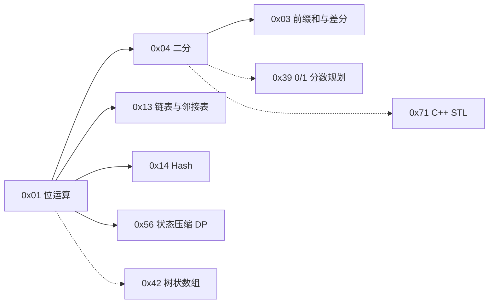
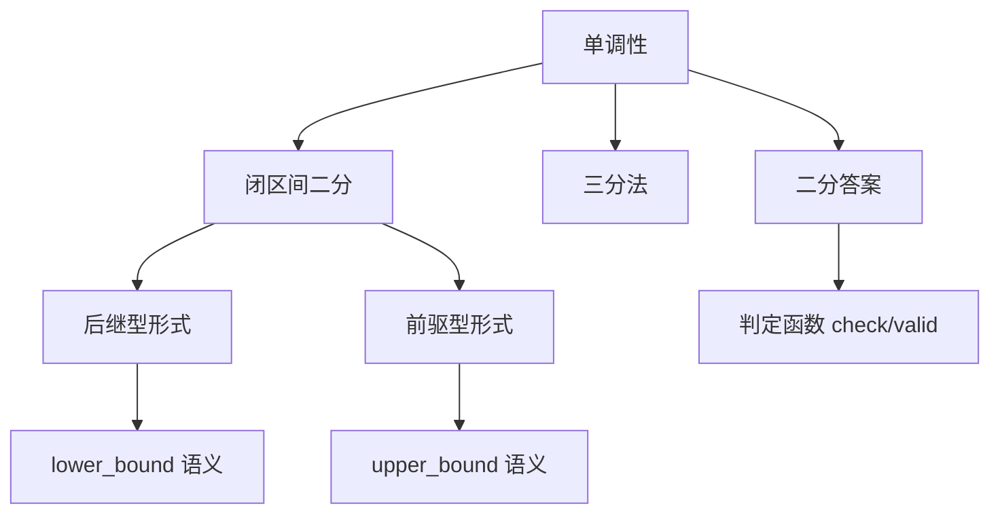

# 知识依赖关系

> 原则：
> - **不按章节顺序推断依赖**。
> - 每条边标注性质：`明确`（书中有表述）/ `推断`（整理者判断）/ `待确认`。
> - 目前只登记已读章节（0x04）的边，其余章节待整理后补充。

## 1. 图例

| 线型 | 含义 |
| --- | --- |
| 实线 `-->` | 明确依赖（书中有依据） |
| 虚线 `-.->` | 推断依赖 |
| 点线 `..>` | 待确认 |

> 注：`0x03 前缀和与差分` 在目录中位于 0x04 之前，但依赖方向是「0x04 的例题用到 0x03」，
> 不是前置依赖，图中箭头方向据此绘制。

## 2. 逐条说明

| 编号 | 起点 → 终点 | 性质 | 依据 |
| --- | --- | --- | --- |
| D-001 | 0x01 位运算 → 0x04 二分 | **明确** | 书中说明二分用 `>> 1` 而非 `/ 2`，并指出「第 0x01 节曾提到了二者的区别」`[BOOK] p.26` |
| D-002 | 0x04 二分 → 0x03 前缀和 | **明确** | Best Cow Fences 的判定把子段和转化为前缀和相减 `[BOOK] p.30` |
| D-003 | 0x04 → 0x39 0/1 分数规划 | 推断 | 0/1 分数规划以实数二分为工具；具体表述需读 0x39 确认 `[DERIVED]` |
| D-004 | 0x04 → 0x71 C++ STL | 待确认 | 书中提到 `lower_bound` / `upper_bound` 见 0x71 `[BOOK] p.27`；方向待定 |
| D-005 | 0x04 → 0x42 树状数组 / 0x43 线段树 | 待确认 | 树形结构上二分是常见组合，书中表述未读 |
| D-006 | 0x01 → 0x13 链表与邻接表 | **明确** | `xor 1` 成对变换用于正反向边存储，书中明确指出见 0x13 `[BOOK] p.9` |
| D-007 | 0x01 → 0x14 Hash | **明确** | `lowbit` 配合 Hash 枚举所有 1 位，书中指向 0x14 `[BOOK] p.10` |
| D-008 | 0x01 → 0x56 状态压缩 DP | **明确** | Hamilton 路径例题明确「将在第 0x56 节详细讲解」`[BOOK] p.7` |
| D-009 | 0x01 → 0x42 树状数组 | 推断 | lowbit 是树状数组核心，但书中在本章未提及 0x42 `[DERIVED]` |

## 3. 概念级的局部关系（0x04 内部）

| 关系 | 性质 | 依据 |
| --- | --- | --- |
| 单调性 → 闭区间二分 | 明确 | `[BOOK] p.25–26` |
| 后继型 / 前驱型 → lower/upper_bound 语义 | 明确 | `[BOOK] p.27` 提及 STL 实现「后继」查找 |
| 单调性 → 三分法 | 明确 | 三分要求严格单调 `[BOOK] p.28` |
| 单调性 → 二分答案 | 明确 | 值域单调性是二分答案的前提 `[BOOK] p.28` |

## 4. 待补

- 0x10、0x40、0x50、0x60 的内部依赖（如线段树 → 树状数组、DP 优化 → 数据结构）
- 跨章依赖（如 0x56 状态压缩 DP → 0x01 位运算、0x61 最短路 → 0x62 MST）
- 每条新增边都需给出页码依据或标 `推断`
