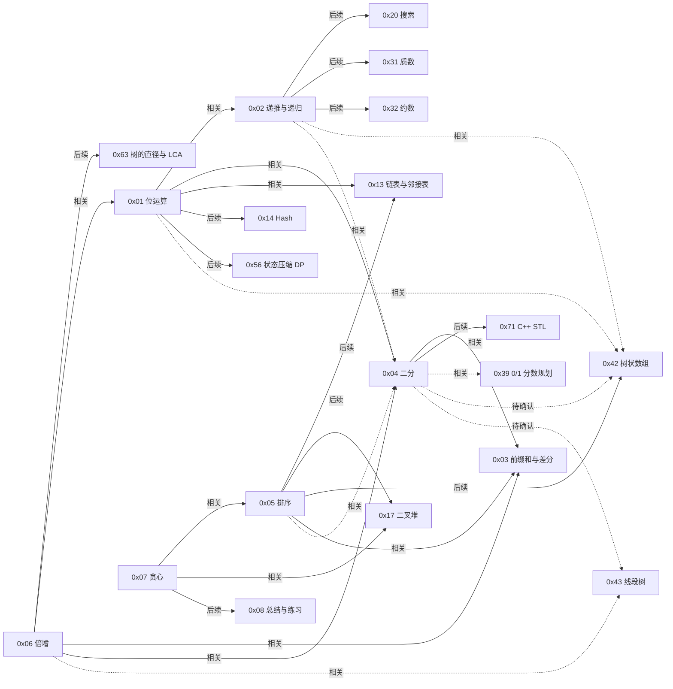
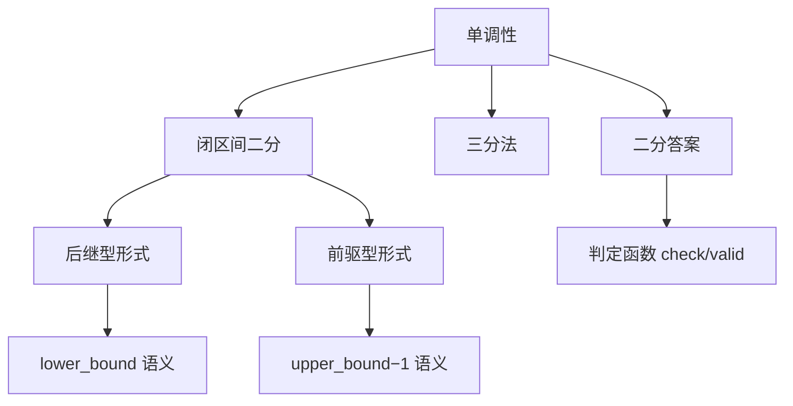

# 知识依赖关系

> 原则：
> - **不按章节顺序推断依赖**。
> - 每条边标注性质：`明确`（书中有表述）/ `推断`（整理者判断）/ `待确认`。
> - 关系分三类：**前置依赖**（要读懂本章必须先掌握）、**相关知识**（互相参照）、**后续引用**（书中说「见某章」）。
>   「书中提到某章」不等于「本章依赖该章」，例如统计「相等元素个数」用到 0x04，只是引用。
> - 进度：已整理 0x01、0x02、0x04 三章；其余章节待补充。

## 1. 图例

| 线型 | 含义 |
| --- | --- |
| 实线 `-->` | 明确关系（书中有依据） |
| 虚线 `-.->` | 推断关系 |
| 点线 `..>` | 待确认 |

> 线型表示**依据强度**：实线 = 书中明确写出；虚线 = 整理者推断；点线 = 待确认。
> 边上的标签表示**关系类型**：`前置`（要读懂本章必须先掌握）、`相关`（互相参照）、`后续`（书中「详见某章」）。
> **依据强度与关系类型是两个独立维度**，「实线 + 相关」表示书中明确写出的相关知识，而非依赖。

### 关系类型分类

| 编号 | 关系 | 关系类型 | 依据强度 |
| --- | --- | --- | --- |
| D-001 | 0x01 → 0x04 | 相关知识（实现细节） | 明确 |
| D-002 | 0x04 → 0x03 | 相关知识 | 明确 |
| D-003 | 0x04 → 0x39 | 相关知识 | 推断 |
| D-004 | 0x04 → 0x71 | 后续引用 | 明确 |
| D-005 | 0x04 → 0x42 / 0x43 | 待确认 | 待确认 |
| D-006 | 0x01 → 0x13 | 相关知识 | 明确 |
| D-007 | 0x01 → 0x14 | 后续引用 | 明确 |
| D-008 | 0x01 → 0x56 | 后续引用 | 明确 |
| D-009 | 0x01 → 0x42 | 相关知识 | 推断 |
| D-010 | 0x01 → 0x02 | 相关知识（非必要前置） | 明确 |
| D-011 | 0x02 → 0x20 | 后续引用 | 明确 |
| D-012 | 0x02 → 0x31 | 后续引用 | 明确 |
| D-013 | 0x02 → 0x32 | 后续引用 | 明确 |
| D-014 | 0x02 → 0x42 | 相关知识 | 推断 |
| D-015 | 0x02 → 0x04 | 相关知识 | 推断 |
| D-016 | 0x05 → 0x13 | 后续引用 | 明确 |
| D-017 | 0x05 → 0x17 | 后续引用 | 明确 |
| D-018 | 0x05 → 0x42 | 后续引用 | 明确 |
| D-019 | 0x05 → 0x03 | 相关知识 | 明确 |
| D-020 | 0x05 → 0x04 | 相关知识 | 推断 |
| D-021 | 0x06 → 0x63 | 后续引用 | 明确 |
| D-022 | 0x06 → 0x01 | 相关知识 | 明确 |
| D-023 | 0x06 → 0x03 | 相关知识 | 明确 |
| D-024 | 0x06 → 0x04 | 相关知识 | 明确 |
| D-025 | 0x06 → 0x43 | 相关知识 | 推断 |
| D-026 | 0x07 → 0x05 | 相关知识 | 明确 |
| D-027 | 0x07 → 0x17 | 相关知识 | 明确 |
| D-028 | 0x07 → 0x08 | 后续引用 | 明确 |

> **前置依赖：目前未发现书中以「必须先掌握」明确表述的关系。**
> D-001 与 D-010 曾被标为「前置」，复核后确认它们只是实现细节或章首引用，
> 不属于理解本章的必要条件，已降级为「相关知识」。

## 2. 逐条说明

| 编号 | 起点 → 终点 | 关系类型 | 依据强度 | 依据 |
| --- | --- | --- | --- | --- |
| D-001 | 0x01 位运算 → 0x04 二分 | 相关知识（实现细节） | **明确** | 书中说明二分用 `>> 1` 而非 `/ 2`，并回指「第 0x01 节曾提到二者的区别」`[BOOK] p.26`。这是**实现细节**，不理解位运算也能理解二分的区间收缩，故不算前置 |
| D-002 | 0x04 二分 → 0x03 前缀和 | 相关知识 | **明确** | Best Cow Fences 的判定把子段和转化为前缀和相减 `[BOOK] p.30` |
| D-003 | 0x04 → 0x39 0/1 分数规划 | 相关知识 | 推断 | 0/1 分数规划以实数二分为工具；具体表述需读 0x39 确认 `[DERIVED]` |
| D-004 | 0x04 → 0x71 C++ STL | 后续引用 | **明确** | 书中指出 `lower_bound`/`upper_bound` 用法「参见第 0x71 节」`[BOOK] p.27` |
| D-005 | 0x04 → 0x42 / 0x43 | 待确认 | 待确认 | 树形结构上二分是常见组合，但书中未在 0x04 提及 |
| D-006 | 0x01 → 0x13 链表与邻接表 | 相关知识 | **明确** | `xor 1` 成对变换用于正反向边存储，书中明确指出见 0x13 `[BOOK] p.9` |
| D-007 | 0x01 → 0x14 Hash | 后续引用 | **明确** | `lowbit` 配合 Hash 枚举所有 1 位，书中指向 0x14 `[BOOK] p.10` |
| D-008 | 0x01 → 0x56 状态压缩 DP | 后续引用 | **明确** | Hamilton 路径例题明确「将在第 0x56 节详细讲解」`[BOOK] p.7` |
| D-009 | 0x01 → 0x42 树状数组 | 相关知识 | 推断 | lowbit 是树状数组核心，但书中在本章未提及 0x42 `[DERIVED]` |
| D-010 | 0x01 → 0x02 递推与递归 | 相关知识（非必要前置） | **明确** | 章首承接 0x01 末尾的 GCC 内建函数说明；指数型枚举也可用位运算实现 `[BOOK] p.11, p.14`。但不懂位运算同样能理解递归的「缩小/求解/扩展」，**不构成前置依赖** |
| D-011 | 0x02 → 0x20 搜索 | 后续引用 | **明确** | 「关于搜索及其剪枝，我们将从第 0x20 节开始用一章的篇幅详细讲解」`[BOOK] p.15` |
| D-012 | 0x02 → 0x31 质数 | 后续引用 | **明确** | Sumdiv 例题说明将在此节介绍分解质因数 `[BOOK] p.17` |
| D-013 | 0x02 → 0x32 约数 | 后续引用 | **明确** | 同上 `[BOOK] p.17` |
| D-014 | 0x02 → 0x42 树状数组 | 相关知识 | 推断 | 本章开篇提到 lowbit 也是树状数组基本运算，但非本章依赖 `[DERIVED]` |
| D-015 | 0x02 → 0x04 二分 | 相关知识 | 推断 | 分治思想与二分同源，书中未直接建立联系 `[DERIVED]` |
| D-016 | 0x05 → 0x13 链表与邻接表 | 后续引用 | **明确** | Running Median 的离线做法「链表 + Hash」见 0x13 `[BOOK] p.36` |
| D-017 | 0x05 → 0x17 二叉堆 | 后续引用 | **明确** | 对顶堆依赖二叉堆，书中指向 0x17 `[BOOK] p.36` |
| D-018 | 0x05 → 0x42 树状数组 | 后续引用 | **明确** | 书中提到求逆序对还可用树状数组 `[BOOK] p.38` |
| D-019 | 0x05 → 0x03 前缀和与差分 | 相关知识 | **明确** | 均分纸牌与环形均分都用前缀和 `[BOOK] p.35` |
| D-020 | 0x05 → 0x04 二分 | 相关知识 | 推断 | 离散化查询用 `lower_bound`，书中未直接建立依赖 `[DERIVED]` |
| D-021 | 0x06 → 0x63 树的直径与 LCA | 后续引用 | **明确** | 书中指出树上倍增（LCA）将在 0x63 讨论 `[BOOK] p.39` |
| D-022 | 0x06 → 0x01 位运算 | 相关知识 | **明确** | 书中指出快速幂是「倍增 + 二进制划分」的体现 `[BOOK] p.39` |
| D-023 | 0x06 → 0x03 前缀和与差分 | 相关知识 | **明确** | 倍增查找用前缀和判定区间和 `[BOOK] p.40` |
| D-024 | 0x06 → 0x04 二分 | 相关知识 | **明确** | 书中对比二分在答案极小时的低效 `[BOOK] p.40` |
| D-025 | 0x06 → 0x43 线段树 | 相关知识 | 推断 | 同为 RMQ 结构，书中未在本章比较 `[DERIVED]` |
| D-026 | 0x07 → 0x05 排序 | 相关知识 | **明确** | 四道例题都先排序再扫描 `[BOOK] p.43–45` |
| D-027 | 0x07 → 0x17 二叉堆 | 相关知识 | **明确** | Stall Reservations 用小根堆优化 `[BOOK] p.43` |
| D-028 | 0x07 → 0x08 总结与练习 | 后续引用 | **明确** | 贪心在 0x08 纳入知识框架 `[BOOK] p.46` |

## 3. 概念级的局部关系（0x04 内部）

| 关系 | 性质 | 依据 |
| --- | --- | --- |
| 单调性 → 闭区间二分 | 明确 | `[BOOK] p.25–26` |
| 后继型 → `lower_bound` | 明确 | `[BOOK] p.27` 提及 STL 实现「后继」查找 |
| 前驱型 → `upper_bound−1`（需判边界） | 推断 | 书中未展开 `upper_bound` 精确语义，由 `[DERIVED]` 推出 |
| 单调性 → 三分法 | 明确 | 三分要求严格单调 `[BOOK] p.28` |
| 单调性 → 二分答案 | 明确 | 值域单调性是二分答案的前提 `[BOOK] p.28` |

## 4. 待补

- 0x10、0x40、0x50、0x60 的内部依赖（如线段树 → 树状数组、DP 优化 → 数据结构）
- 跨章依赖（如 0x56 状态压缩 DP → 0x01 位运算、0x61 最短路 → 0x62 MST）
- 每条新增边都需给出页码依据或标 `推断`
