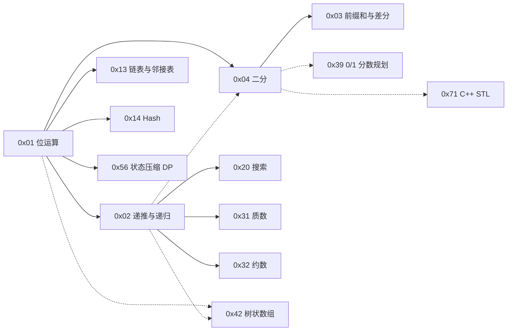
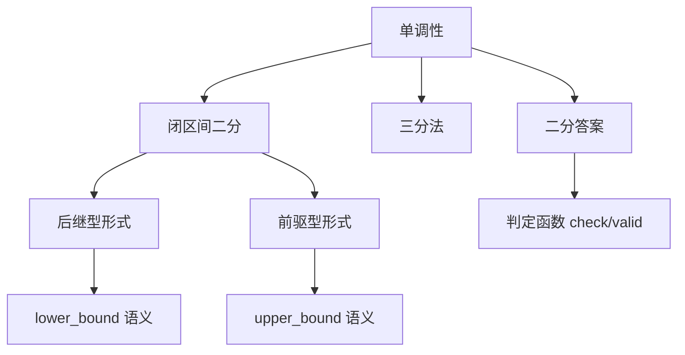

# 知识依赖关系

> 原则：
> - **不按章节顺序推断依赖**。
> - 每条边标注性质：`明确`（书中有表述）/ `推断`（整理者判断）/ `待确认`。
> - 关系分三类：**前置依赖**（要读懂本章必须先掌握）、**相关知识**（互相参照）、**后续引用**（书中说「见某章」）。
>   「书中提到某章」不等于「本章依赖该章」，例如统计「相等元素个数」用到 0x04，只是引用。
> - 进度：已整理 0x01、0x02、0x04 三章；其余章节待补充。

## 1. 图例

| 线型 | 含义 |
| --- | --- |
| 实线 `-->` | 明确依赖（书中有依据） |
| 虚线 `-.->` | 推断依赖 |
| 点线 `..>` | 待确认 |

> 说明：
> - 实线 = 书中明确写出的关系（含「见某章」「见某节」的引用）。
> - 虚线 = 整理者推断；点线 = 待确认。
> - `0x03 前缀和与差分` 在目录中位于 0x04 之前，但 0x04 的例题用到 0x03，箭头方向按实际用途绘制。
> - 本章（0x02）指向 0x20 / 0x31 / 0x32 的边，都是书中「详见某章」的**后续引用**，不是前置依赖。

### 关系类型分类

| 编号 | 关系 | 类型 |
| --- | --- | --- |
| D-001 | 0x01 → 0x04 | 前置依赖（右移与除法的区别） |
| D-002 | 0x04 → 0x03 | 相关知识（例题用到前缀和） |
| D-003 | 0x04 → 0x39 | 相关知识（推断） |
| D-004 | 0x04 → 0x71 | 后续引用（STL 使用说明） |
| D-005 | 0x04 → 0x42/0x43 | 待确认 |
| D-006 | 0x01 → 0x13 | 相关知识（成对变换用于邻接表） |
| D-007 | 0x01 → 0x14 | 后续引用（lowbit 配合 Hash） |
| D-008 | 0x01 → 0x56 | 后续引用（Hamilton 例题指向状压） |
| D-009 | 0x01 → 0x42 | 相关知识（推断） |
| D-010 | 0x01 → 0x02 | 前置依赖（承接 lowbit 说明；指数枚举可位运算） |
| D-011 | 0x02 → 0x20 | 后续引用（剪枝详见搜索章） |
| D-012 | 0x02 → 0x31 | 后续引用（Sumdiv 分解质因数） |
| D-013 | 0x02 → 0x32 | 后续引用（约数内容） |
| D-014 | 0x02 → 0x42 | 相关知识（推断，lowbit 仅被提及） |
| D-015 | 0x02 → 0x04 | 相关知识（推断，分治与二分同源） |

## 2. 逐条说明

| 编号 | 起点 → 终点 | 性质 | 依据 |
| --- | --- | --- | --- |
| D-001 | 0x01 位运算 → 0x04 二分 | **明确** | 书中说明二分用 `>> 1` 而非 `/ 2`，并指出「第 0x01 节曾提到了二者的区别」`[BOOK] p.26` |
| D-002 | 0x04 二分 → 0x03 前缀和 | **明确** | Best Cow Fences 的判定把子段和转化为前缀和相减 `[BOOK] p.30` |
| D-003 | 0x04 → 0x39 0/1 分数规划 | 推断 | 0/1 分数规划以实数二分为工具；具体表述需读 0x39 确认 `[DERIVED]` |
| D-004 | 0x04 → 0x71 C++ STL | 待确认 | 书中提到 `lower_bound` / `upper_bound` 见 0x71 `[BOOK] p.27`；方向待定 |
| D-005 | 0x04 → 0x42 树状数组 / 0x43 线段树 | 待确认 | 树形结构上二分是常见组合，书中表述未读 |
| D-006 | 0x01 → 0x13 链表与邻接表 | **明确** | `xor 1` 成对变换用于正反向边存储，书中明确指出见 0x13 `[BOOK] p.9` |
| D-007 | 0x01 → 0x14 Hash | **明确** | `lowbit` 配合 Hash 枚举所有 1 位，书中指向 0x14 `[BOOK] p.10` |
| D-008 | 0x01 → 0x56 状态压缩 DP | **明确** | Hamilton 路径例题明确「将在第 0x56 节详细讲解」`[BOOK] p.7` |
| D-009 | 0x01 → 0x42 树状数组 | 推断 | lowbit 是树状数组核心，但书中在本章未提及 0x42 `[DERIVED]` |
| D-010 | 0x01 → 0x02 递推与递归 | **明确** | 章节开篇承接 0x01 末尾的 GCC 内建函数；指数型枚举也可用位运算实现 `[BOOK] p.11, p.14` |
| D-011 | 0x02 → 0x20 搜索 | **明确** | 「关于搜索及其剪枝，我们将从第 0x20 节开始用一章的篇幅详细讲解」`[BOOK] p.15` |
| D-012 | 0x02 → 0x31 质数 | **明确** | Sumdiv 例题说明将在此节介绍分解质因数 `[BOOK] p.17` |
| D-013 | 0x02 → 0x32 约数 | **明确** | 同上 `[BOOK] p.17` |
| D-014 | 0x02 → 0x42 树状数组 | 推断 | 本章开篇提到 lowbit 也是树状数组基本运算，但非本章依赖 `[DERIVED]` |
| D-015 | 0x02 → 0x04 二分 | 推断 | 分治思想与二分同源，书中未直接建立联系 `[DERIVED]` |

## 3. 概念级的局部关系（0x04 内部）

| 关系 | 性质 | 依据 |
| --- | --- | --- |
| 单调性 → 闭区间二分 | 明确 | `[BOOK] p.25–26` |
| 后继型 / 前驱型 → lower/upper_bound 语义 | 明确 | `[BOOK] p.27` 提及 STL 实现「后继」查找 |
| 单调性 → 三分法 | 明确 | 三分要求严格单调 `[BOOK] p.28` |
| 单调性 → 二分答案 | 明确 | 值域单调性是二分答案的前提 `[BOOK] p.28` |

## 4. 待补

- 0x10、0x40、0x50、0x60 的内部依赖（如线段树 → 树状数组、DP 优化 → 数据结构）
- 跨章依赖（如 0x56 状态压缩 DP → 0x01 位运算、0x61 最短路 → 0x62 MST）
- 每条新增边都需给出页码依据或标 `推断`
